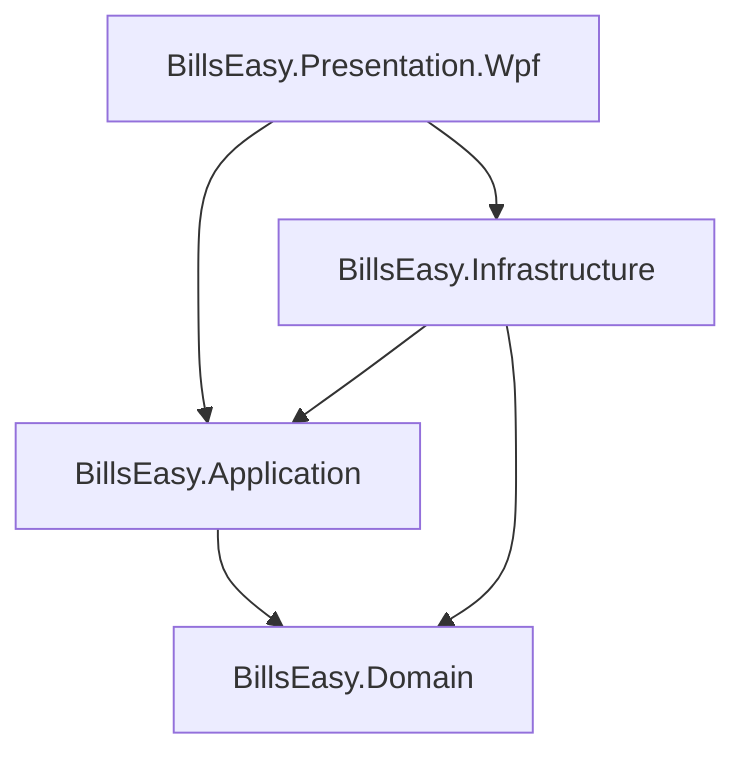

# 02. Current Architecture

## 1. Clean Architecture Dependency Graph

### Dependency Rules & Layer Invariants:
1. **`BillsEasy.Domain`**:
   - Zero project dependencies.
   - Zero NuGet package dependencies.
   - Pure C# domain logic, entities, value objects, domain exceptions, and domain enums.
2. **`BillsEasy.Application`**:
   - Depends **only** on `BillsEasy.Domain`.
   - Contains DTOs, Service interfaces, Repository interfaces, application use-case services, and domain constants.
   - No direct reference to `Microsoft.Data.Sqlite` or WPF UI libraries.
3. **`BillsEasy.Infrastructure`**:
   - Implements Application repository and factory interfaces (`ILedgerRepository`, `IAccountGroupRepository`, `ICompanyRepository`, `IFinancialYearRepository`, `ISqliteDbConnectionFactory`).
   - Uses `Microsoft.Data.Sqlite` (v8.0.8) with raw ADO.NET SQL commands (zero heavyweight ORM / EF Core runtime overhead).
4. **`BillsEasy.Presentation.Wpf`**:
   - Desktop UI layer built with WPF on .NET 8.
   - Uses `CommunityToolkit.Mvvm` (v8.3.2) and `Microsoft.Extensions.DependencyInjection` (v8.0.0).
   - Dialogs and Views bind directly to ViewModels; zero business logic in XAML code-behind (`.xaml.cs`).

---

## 2. Layer-by-Layer Inventory

### A. Domain Layer (`src/BillsEasy.Domain`)
- **Entities:**
  - `Entity<TId>`: Base class providing generic strongly-typed ID and equality semantics.
  - `AuditableEntity<TId>`: Base class providing `CreatedAt`, `CreatedBy`, `ModifiedAt`, `ModifiedBy` and `UpdateAudit(user, timestamp)` lifecycle method.
  - `Company`: Root aggregate holding master company profile, books beginning date, GSTIN, and collection of `FinancialYears`.
  - `FinancialYear`: Entity scoped to a company, holding date range (`StartDate` to `EndDate`), `IsActive`, and `IsLocked` flags.
  - `AccountGroup`: Aggregate entity defining group classification (`GroupNature`), hierarchical relationship (`ParentGroupId`), and system protection flags.
  - `Ledger`: Single authoritative aggregate for accounts and parties, holding statutory GST/PAN data, contact, banking, bill-wise settings, and setup opening balance.
- **Value Objects:**
  - `Money`: Immutable currency value object wrapping `decimal Amount` with 2-decimal rounding (`MidpointRounding.AwayFromZero`) and arithmetic operator overloads (`+`, `-`, `*`, `>`, `<`).
- **Enums:**
  - `GroupNature`: `Asset = 1`, `Liability = 2`, `Capital = 3`, `Income = 4`, `Expense = 5`.
  - `DebitCreditType`: `Debit = 1`, `Credit = 2`.
  - `GSTRegistrationType`: `Regular = 1`, `Composition = 2`, `Unregistered = 3`, `Consumer = 4`, `Overseas = 5`, `SpecialEconomicZone = 6`.

### B. Application Layer (`src/BillsEasy.Application`)
- **Use Case Services:**
  - `CompanyService`: Creation, modification, duplicate name checking, and auto-seeding of standard account groups & default ledgers upon company creation.
  - `FinancialYearService`: Creation with non-overlap invariants, active year switching with single-active enforcement, year locking.
  - `AccountGroupService`: CRUD for groups, sibling uniqueness validation, circular hierarchy traversal detection, taxonomy seeding (25+ standard Indian accounting groups), and deletion guards.
  - `LedgerService`: CRUD for ledgers, GSTIN/PAN validations, company isolation, group belonging verification, default ledger seeding (`Cash`, `Profit & Loss Account`), and deletion guards.
- **DTOs:**
  - `CompanyDto`, `CreateCompanyDto`, `UpdateCompanyDto`, `FinancialYearDto`, `CreateFinancialYearDto`.
  - `AccountGroupDto`, `CreateAccountGroupDto`, `UpdateAccountGroupDto`, `AccountGroupNodeDto` (for UI tree views).
  - `LedgerDto`, `CreateLedgerDto`, `UpdateLedgerDto`, `LedgerSummaryDto`.

### C. Infrastructure Layer (`src/BillsEasy.Infrastructure`)
- **Persistence & Factory:**
  - `ISqliteDbConnectionFactory` / `SqliteConnectionFactory`: Opens connections with `PRAGMA journal_mode = WAL; PRAGMA foreign_keys = ON; PRAGMA busy_timeout = 5000;`.
  - `DatabaseInitializer`: Synchronously/asynchronously executes idempotent schema DDL with composite indices and unique constraints.
- **Repositories (Raw Parameterized SQL):**
  - `CompanyRepository`: Full aggregate persistence including child `FinancialYears`.
  - `FinancialYearRepository`: Scoped queries, atomic single-active transaction updates.
  - `AccountGroupRepository`: Sibling uniqueness checks, hierarchy queries, child/ledger dependency count checks.
  - `LedgerRepository`: Search, group filtering, transaction/bill reference checks (ready for Phase 1.5 voucher foreign key checks).
- **Services:**
  - `CompanyContextService`: In-memory session context tracking `ActiveCompany` and `ActiveFinancialYear` across the application lifecycle.
  - `DateTimeProvider`: Abstraction over `DateTime.UtcNow`.
  - `StandaloneCurrentUserService`: Current desktop user identification (returns `"system_admin"`).

### D. Presentation Layer (`src/BillsEasy.Presentation.Wpf`)
- **MVVM Pattern:**
  - `MainWindowViewModel`: Menu commands, status bar bindings, context switching.
  - `CompanyListViewModel` & `CompanyEditViewModel`: Company selection and creation.
  - `FinancialYearManagementViewModel`: Multi-year listing, active switching, new FY creation.
  - `AccountGroupListViewModel` & `AccountGroupEditViewModel`: Dual-mode List and Tree hierarchy views with nature badges.
  - `LedgerListViewModel` & `LedgerEditViewModel`: High-density tabbed account management dialog (4 tabs: Basic, Opening & Credit, Statutory & Address, Contact & Banking).

---

## 3. Architectural Boundary Analysis & Compliance Verification

| Architectural Principle | Compliance Status | Proof / Evidence |
|---|---|---|
| Domain has zero Infrastructure dependencies | **PASS** | `BillsEasy.Domain.csproj` has zero project and package references. |
| Application has zero SQLite/ADO.NET dependencies | **PASS** | `BillsEasy.Application.csproj` references only `BillsEasy.Domain`. |
| Zero business logic in UI Code-Behind | **PASS** | All `.xaml.cs` files contain only standard constructor `InitializeComponent()`. |
| No separate Party / Customer / Supplier tables | **PASS** | Customers and Suppliers exist solely in `Ledgers` table under `Sundry Debtors` / `Sundry Creditors`. |
| No cached / running balance columns | **PASS** | `Ledgers` table has zero `CurrentBalance` or `ClosingBalance` fields. |
| Minor units integer monetary storage | **PASS** | `OpeningBalance` & `CreditLimit` stored as `INTEGER` paise with zero float drift. |
| Database-level enum CHECK constraints | **PASS** | Enforced via `CHECK` on `Nature`, `OpeningBalanceType`, `GSTRegistrationType`. |
| Case-insensitive company uniqueness | **PASS** | Enforced via `UQ_Companies_Name` with `COLLATE NOCASE`. |
| Single active FY database constraint | **PASS** | Enforced via partial unique index `UQ_FinancialYears_Company_OneActive WHERE IsActive = 1`. |
| Domain aggregate invariant encapsulation | **PASS** | `AccountGroup.Reparent` and `Ledger.UpdateOpeningBalance` encapsulate rules in Domain entities. |
