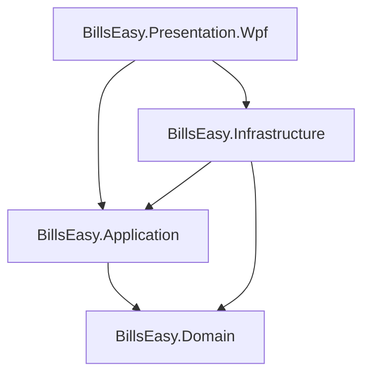

# BILLSEASY — COMPLETE ARCHITECTURE REVIEW PACKAGE (PHASES 1.1 - 1.4)


================================================================================
FILE: CLAUDE_REVIEW_PROMPT.md
================================================================================

# CLAUDE ARCHITECTURE & DOMAIN REVIEW PROMPT

> **Instructions for the Reviewer:**
> You are acting as an independent Principal Software Architect and Lead Accounting Domain Specialist.
> Your task is to perform an exhaustive, critical, and unsparing review of the **BillsEasy** accounting software foundation (Phases 1.1 through 1.4) before development is authorized to proceed to Phase 1.5 (Voucher Engine).

---

## 📋 Context & Project Identity
- **Project:** BillsEasy (Native Windows Desktop Accounting Application for Indian SMEs).
- **Core Stack:** C# (.NET 8.0 LTS), WPF (MVVM with CommunityToolkit.Mvvm), Embedded SQLite (WAL mode, Foreign Keys enabled), Clean Architecture.
- **Current Milestone:** Completed Phase 1.1 (Core Foundation), Phase 1.2 (Company & Financial Year), Phase 1.3 (Account Groups & Hierarchy), and Phase 1.4 (Ledger / Account Master).
- **Review Artifacts:** All review documents are located in `docs/claude-review/`:
  - `01_EXECUTIVE_SUMMARY.md`
  - `02_CURRENT_ARCHITECTURE.md`
  - `03_DOMAIN_MODEL.md`
  - `04_DATABASE_SCHEMA.md`
  - `05_COMPANY_FINANCIAL_YEAR.md`
  - `06_ACCOUNT_GROUPS.md`
  - `07_LEDGER_MODEL.md`
  - `08_AUDIT_USER_MODEL.md`
  - `09_SQLITE_DESKTOP_ARCHITECTURE.md`
  - `10_WPF_MVVM_ARCHITECTURE.md`
  - `11_TESTING_STATUS.md`
  - `12_VOUCHER_ENGINE_READINESS.md`
  - `13_RISKS_AND_GAPS.md`
  - `14_ARCHITECTURAL_DECISIONS.md`
  - `15_REVIEW_QUESTIONS_FOR_CLAUDE.md`
  - `DATABASE_SCHEMA.sql`
  - `CURRENT_PROJECT_TREE.txt`

---

## 🎯 Review Objectives
Please read all the review documents and provide an independent architectural verdict.

In your review, please address:
1. **Core Accounting Domain Modeling:**
   - Verify that treating Customers and Suppliers purely as `Ledger` instances under `Sundry Debtors` / `Sundry Creditors` (without a separate `Party` table) is sound and adheres to established Indian accounting principles (BUSY/Tally).
   - Evaluate the setup `OpeningBalance` on `Ledger` vs transaction-derived balances.
2. **Relational Schema & Database Design:**
   - Critique the SQLite schema in `DATABASE_SCHEMA.sql`, foreign keys, composite unique indexes (`COLLATE NOCASE`), and delete restrictions.
   - Evaluate currency precision (`REAL` vs `INTEGER` minor units / paise).
3. **Clean Architecture & Code Separation:**
   - Verify strict separation of Domain, Application, Infrastructure, and WPF Presentation.
4. **Voucher Engine Readiness (Phase 1.5):**
   - Identify any missing domain fields, aggregate boundary conflicts, or locking risks that must be fixed before Phase 1.5 implementation starts.

---

## 📊 Required Verdict Format

Please conclude your review with one of three formal verdicts:

- **[A] GO** — The architecture and domain model are fully sound, verified, and ready for Phase 1.5 Voucher Engine.
- **[B] GO WITH REQUIRED CHANGES** — Minor adjustments or constraints required before proceeding to Phase 1.5 (specify exact changes).
- **[C] NO-GO** — Critical architectural or domain defects identified; require refactoring before proceeding.

Along with a prioritized action list categorized as:
- **Blockers (Must fix before Phase 1.5)**
- **Recommendations for Phase 1.5+**
- **Future Considerations (PostgreSQL / LAN edition)**


================================================================================
FILE: CURRENT_PROJECT_TREE.txt
================================================================================

================================================================================
BILLSEASY — CURRENT PROJECT TREE (PHASES 1.1 - 1.4 COMPLETE)
================================================================================
Directory of W:\BillsEasy:

W:\BillsEasy\
├── .gitignore
├── BillsEasy.sln
├── run.bat
├── docs\
│   ├── ACCOUNTING_ENGINE_CONSTRAINTS.md
│   ├── ARCHITECTURE.md
│   ├── AUDIT_TRAIL.md
│   ├── DATABASE_DESIGN.md
│   ├── DECISION_LOG.md
│   ├── DEVELOPMENT_ENVIRONMENT.md
│   ├── DOMAIN_MODEL.md
│   ├── MASTER_PROJECT_CHARTER.md
│   ├── MODULE_BOUNDARIES.md
│   ├── PHASE_1_1_IMPLEMENTATION_REPORT.md
│   ├── PHASE_1_2_ARCHITECTURE_GATE.md
│   ├── PHASE_1_2_IMPLEMENTATION_REPORT.md
│   ├── PHASE_1_3_IMPLEMENTATION_REPORT.md
│   ├── PHASE_1_4_IMPLEMENTATION_REPORT.md
│   ├── REFERENCE_SOFTWARE.md
│   ├── REFERENCE_SOURCES.md
│   ├── SECURITY_MODEL.md
│   ├── SOURCE_PROVENANCE.md
│   ├── TECHNOLOGY_NOTES.md
│   ├── UI_ARCHITECTURE.md
│   └── claude-review\
├── src\
│   ├── BillsEasy.Domain\
│   │   ├── BillsEasy.Domain.csproj
│   │   ├── Common\
│   │   │   ├── AuditableEntity.cs
│   │   │   ├── DomainException.cs
│   │   │   ├── Entity.cs
│   │   │   └── IAuditableEntity.cs
│   │   ├── Entities\
│   │   │   ├── AccountGroup.cs
│   │   │   ├── Company.cs
│   │   │   ├── FinancialYear.cs
│   │   │   └── Ledger.cs
│   │   ├── Enums\
│   │   │   ├── DebitCreditType.cs
│   │   │   ├── GroupNature.cs
│   │   │   └── GSTRegistrationType.cs
│   │   └── ValueObjects\
│   │       └── Money.cs
│   ├── BillsEasy.Application\
│   │   ├── BillsEasy.Application.csproj
│   │   ├── Common\
│   │   │   ├── IndianStates.cs
│   │   │   └── Interfaces\
│   │   │       ├── IAccountGroupRepository.cs
│   │   │       ├── IAccountGroupService.cs
│   │   │       ├── ICompanyContextService.cs
│   │   │       ├── ICompanyRepositories.cs
│   │   │       ├── ICurrentUserService.cs
│   │   │       ├── IDateTimeProvider.cs
│   │   │       ├── ILedgerRepository.cs
│   │   │       ├── ILedgerService.cs
│   │   │       └── ISqliteDbConnectionFactory.cs
│   │   ├── DTOs\
│   │   │   ├── AccountGroupDtos.cs
│   │   │   ├── CompanyDtos.cs
│   │   │   └── LedgerDtos.cs
│   │   └── Services\
│   │       ├── AccountGroupService.cs
│   │       ├── CompanyService.cs
│   │       ├── FinancialYearService.cs
│   │       └── LedgerService.cs
│   ├── BillsEasy.Infrastructure\
│   │   ├── BillsEasy.Infrastructure.csproj
│   │   ├── Persistence\
│   │   │   ├── DatabaseInitializer.cs
│   │   │   ├── SqliteConnectionFactory.cs
│   │   │   └── Repositories\
│   │   │       ├── AccountGroupRepository.cs
│   │   │       ├── CompanyRepository.cs
│   │   │       ├── FinancialYearRepository.cs
│   │   │       └── LedgerRepository.cs
│   │   └── Services\
│   │       ├── CompanyContextService.cs
│   │       └── DateTimeProvider.cs
│   └── BillsEasy.Presentation.Wpf\
│       ├── App.xaml
│       ├── App.xaml.cs
│       ├── AssemblyInfo.cs
│       ├── BillsEasy.Presentation.Wpf.csproj
│       ├── MainWindow.xaml
│       ├── MainWindow.xaml.cs
│       ├── ViewModels\
│       │   ├── AccountGroupEditViewModel.cs
│       │   ├── AccountGroupListViewModel.cs
│       │   ├── CompanyEditViewModel.cs
│       │   ├── CompanyListViewModel.cs
│       │   ├── FinancialYearManagementViewModel.cs
│       │   ├── LedgerEditViewModel.cs
│       │   ├── LedgerListViewModel.cs
│       │   ├── MainWindowViewModel.cs
│       │   └── ViewModelBase.cs
│       └── Views\
│           ├── Company\
│           │   ├── CompanyEditDialog.xaml
│           │   ├── CompanyEditDialog.xaml.cs
│           │   ├── CompanyListDialog.xaml
│           │   ├── CompanyListDialog.xaml.cs
│           │   ├── FinancialYearManagementDialog.xaml
│           │   └── FinancialYearManagementDialog.xaml.cs
│           └── Masters\
│               ├── AccountGroupEditDialog.xaml
│               ├── AccountGroupEditDialog.xaml.cs
│               ├── AccountGroupManagementDialog.xaml
│               ├── AccountGroupManagementDialog.xaml.cs
│               ├── LedgerEditDialog.xaml
│               ├── LedgerEditDialog.xaml.cs
│               ├── LedgerManagementDialog.xaml
│               └── LedgerManagementDialog.xaml.cs
└── tests\
    ├── BillsEasy.UnitTests\
    │   ├── BillsEasy.UnitTests.csproj
    │   ├── Application\
    │   │   └── Services\
    │   │       ├── AccountGroupServiceTests.cs
    │   │       ├── CompanyServiceTests.cs
    │   │       ├── FinancialYearServiceTests.cs
    │   │       └── LedgerServiceTests.cs
    │   └── Domain\
    │       ├── Common\
    │       │   └── AuditableEntityTests.cs
    │       ├── Entities\
    │       │   ├── AccountGroupTests.cs
    │       │   ├── CompanyTests.cs
    │       │   ├── FinancialYearTests.cs
    │       │   └── LedgerTests.cs
    │       └── ValueObjects\
    │           └── MoneyTests.cs
    └── BillsEasy.IntegrationTests\
        ├── BillsEasy.IntegrationTests.csproj
        └── Infrastructure\
            └── Persistence\
                ├── AccountGroupRepositoryTests.cs
                ├── CompanyRepositoryTests.cs
                ├── FinancialYearRepositoryTests.cs
                ├── LedgerRepositoryTests.cs
                └── SqliteConnectionFactoryTests.cs


================================================================================
FILE: DATABASE_SCHEMA.sql
================================================================================

-- =============================================================================
-- BILLSEASY — CURRENT SQLITE DATABASE SCHEMA (PHASE 1.1 - PHASE 1.4)
-- Generated from src/BillsEasy.Infrastructure/Persistence/DatabaseInitializer.cs
-- Target Database: SQLite 3.x (WAL mode, foreign_keys = ON)
-- =============================================================================

PRAGMA foreign_keys = ON;

-- -----------------------------------------------------------------------------
-- TABLE: Companies
-- Authoritative root aggregate for company profile and accounting metadata.
-- -----------------------------------------------------------------------------
CREATE TABLE IF NOT EXISTS Companies (
    Id TEXT PRIMARY KEY,
    CompanyName TEXT NOT NULL,
    PrintName TEXT NOT NULL,
    ShortName TEXT,
    Country TEXT NOT NULL DEFAULT 'India',
    StateName TEXT NOT NULL,
    StateCode TEXT NOT NULL,
    FinancialYearBeginning TEXT NOT NULL,
    BooksBeginningFrom TEXT NOT NULL,
    CurrencySymbol TEXT NOT NULL DEFAULT '₹',
    CurrencyFormalName TEXT NOT NULL DEFAULT 'INR',
    GSTIN TEXT,
    GSTRegistrationType INTEGER NOT NULL DEFAULT 1,
    IsSecurityEnabled INTEGER NOT NULL DEFAULT 0,
    CreatedAt TEXT NOT NULL,
    CreatedBy TEXT NOT NULL,
    ModifiedAt TEXT,
    ModifiedBy TEXT
);

CREATE UNIQUE INDEX IF NOT EXISTS UQ_Companies_Name 
    ON Companies(CompanyName);

-- -----------------------------------------------------------------------------
-- TABLE: FinancialYears
-- Financial year definitions belonging to a Company.
-- -----------------------------------------------------------------------------
CREATE TABLE IF NOT EXISTS FinancialYears (
    Id TEXT PRIMARY KEY,
    CompanyId TEXT NOT NULL,
    YearName TEXT NOT NULL,
    StartDate TEXT NOT NULL,
    EndDate TEXT NOT NULL,
    IsActive INTEGER NOT NULL DEFAULT 0,
    IsLocked INTEGER NOT NULL DEFAULT 0,
    CreatedAt TEXT NOT NULL,
    CreatedBy TEXT NOT NULL,
    ModifiedAt TEXT,
    ModifiedBy TEXT,
    FOREIGN KEY (CompanyId) REFERENCES Companies(Id) ON DELETE CASCADE
);

CREATE INDEX IF NOT EXISTS IX_FinancialYears_CompanyId 
    ON FinancialYears(CompanyId);

-- -----------------------------------------------------------------------------
-- TABLE: AccountGroups
-- Hierarchical taxonomy for account classification (Asset, Liability, Capital, Income, Expense).
-- Sibling uniqueness: (CompanyId, ParentGroupId, Name)
-- Root uniqueness:    (CompanyId, Name) WHERE ParentGroupId IS NULL
-- -----------------------------------------------------------------------------
CREATE TABLE IF NOT EXISTS AccountGroups (
    Id TEXT PRIMARY KEY,
    CompanyId TEXT NOT NULL,
    Name TEXT NOT NULL,
    ParentGroupId TEXT,
    Nature INTEGER NOT NULL,
    IsPrimary INTEGER NOT NULL DEFAULT 0,
    IsDefaultSystemGroup INTEGER NOT NULL DEFAULT 0,
    CreatedAt TEXT NOT NULL,
    CreatedBy TEXT NOT NULL,
    ModifiedAt TEXT,
    ModifiedBy TEXT,
    FOREIGN KEY (CompanyId) REFERENCES Companies(Id) ON DELETE CASCADE,
    FOREIGN KEY (ParentGroupId) REFERENCES AccountGroups(Id) ON DELETE RESTRICT
);

CREATE UNIQUE INDEX IF NOT EXISTS UQ_AccountGroups_Company_Parent_Name
    ON AccountGroups(CompanyId, ParentGroupId, Name COLLATE NOCASE)
    WHERE ParentGroupId IS NOT NULL;

CREATE UNIQUE INDEX IF NOT EXISTS UQ_AccountGroups_Company_Root_Name
    ON AccountGroups(CompanyId, Name COLLATE NOCASE)
    WHERE ParentGroupId IS NULL;

CREATE INDEX IF NOT EXISTS IX_AccountGroups_ParentGroupId 
    ON AccountGroups(ParentGroupId);

CREATE INDEX IF NOT EXISTS IX_AccountGroups_CompanyId 
    ON AccountGroups(CompanyId);

-- -----------------------------------------------------------------------------
-- TABLE: Ledgers
-- Single authoritative entity for all accounts & parties (Customers, Suppliers, Banks, Expenses, etc.)
-- Unique ledger name per Company: (CompanyId, Name COLLATE NOCASE)
-- Delete restricted when referenced by group.
-- -----------------------------------------------------------------------------
CREATE TABLE IF NOT EXISTS Ledgers (
    Id TEXT PRIMARY KEY,
    CompanyId TEXT NOT NULL,
    GroupId TEXT NOT NULL,
    Name TEXT NOT NULL,
    PrintName TEXT NOT NULL,
    Alias TEXT,
    OpeningBalance REAL NOT NULL DEFAULT 0.0,
    OpeningBalanceType INTEGER NOT NULL DEFAULT 1,
    BillWiseEnabled INTEGER NOT NULL DEFAULT 0,
    CreditPeriodDays INTEGER,
    CreditLimit REAL,
    AddressLine1 TEXT,
    AddressLine2 TEXT,
    City TEXT,
    StateName TEXT,
    StateCode TEXT,
    PinCode TEXT,
    Country TEXT NOT NULL DEFAULT 'India',
    GSTIN TEXT,
    GSTRegistrationType INTEGER NOT NULL DEFAULT 1,
    PAN TEXT,
    AadhaarNumber TEXT,
    ContactPerson TEXT,
    MobileNumber TEXT,
    WhatsAppNumber TEXT,
    Email TEXT,
    BankName TEXT,
    BankAccountNumber TEXT,
    BankIFSC TEXT,
    BankBranch TEXT,
    IsDefaultSystemLedger INTEGER NOT NULL DEFAULT 0,
    CreatedAt TEXT NOT NULL,
    CreatedBy TEXT NOT NULL,
    ModifiedAt TEXT,
    ModifiedBy TEXT,
    FOREIGN KEY (CompanyId) REFERENCES Companies(Id) ON DELETE CASCADE,
    FOREIGN KEY (GroupId) REFERENCES AccountGroups(Id) ON DELETE RESTRICT
);

CREATE UNIQUE INDEX IF NOT EXISTS UQ_Ledgers_Company_Name 
    ON Ledgers(CompanyId, Name COLLATE NOCASE);

CREATE INDEX IF NOT EXISTS IX_Ledgers_GroupId 
    ON Ledgers(GroupId);

CREATE INDEX IF NOT EXISTS IX_Ledgers_CompanyId 
    ON Ledgers(CompanyId);


================================================================================
FILE: 01_EXECUTIVE_SUMMARY.md
================================================================================

# 01. Executive Summary

## 1. Project Identity & Objective
- **Product Name:** BillsEasy
- **Domain:** Native Windows Desktop Accounting Application tailored for Indian SMEs and accountants (BUSY / Tally design philosophy).
- **Core Architecture:** Clean Architecture / Layered Monolith (Domain, Application, Infrastructure, Presentation.Wpf).
- **Technology Stack:** C# (.NET 8.0 LTS), WPF (CommunityToolkit.Mvvm), Embedded SQLite (WAL mode, Foreign Keys ON), xUnit / FluentAssertions / NSubstitute.
- **Current Milestone:** Phase 1.4 Complete (Ready for Independent Architecture Gate before Phase 1.5 Voucher Engine).

---

## 2. Status of Completed Phases

| Phase | Description | Status | Validation Gate |
|---|---|---|---|
| **Phase 1.1** | Solution Scaffolding & Core Domain (`Money`, `AuditableEntity`, SQLite connection factory) | **COMPLETE** | 8/8 Tests Passing |
| **Phase 1.2** | Company & Financial Year Management (Aggregates, Services, SQLite persistence, WPF dialogs) | **COMPLETE** | 33/33 Tests Passing |
| **Phase 1.3** | Account Groups & Hierarchy (Standard 25+ group taxonomy, Sibling uniqueness, Cycle prevention, Tree/List UI) | **COMPLETE** | 72/72 Tests Passing |
| **Phase 1.4** | Ledger / Account Master (Unified Party/Account model, statutory/banking fields, 4-tab UI, seeding Cash/P&L) | **COMPLETE** | **99/99 Tests Passing** (80 Unit, 19 Integration) |
| **Phase 1.5** | Voucher Engine (Voucher, VoucherLine, Double-entry invariants, Dr/Cr balance) | **FROZEN / NOT STARTED** | Pending Claude Architecture Review |

---

## 3. High-Level Architectural Posture
1. **Unified Ledger Model:** Customers and Suppliers are represented strictly as `Ledger` instances under `Sundry Debtors` and `Sundry Creditors` respectively. There are **0 separate Party/Customer/Supplier tables**.
2. **Zero Cached Balances:** There are **0 `CurrentBalance` or `ClosingBalance` columns** in the domain or database. All accounting balances in Phase 1.6+ will be dynamically derived from immutable transaction entries (`VoucherLine`).
3. **Master Setup Opening Balance:** `OpeningBalance` and `OpeningBalanceType` exist on `Ledger` as setup master data only, intended to feed the voucher opening mechanism during financial year transitions.
4. **Auditability:** All aggregates and entities inherit from `AuditableEntity<TId>` (`CreatedAt`, `CreatedBy`, `ModifiedAt`, `ModifiedBy`).
5. **Quality Metrics:**
   - **0 Build Errors, 0 Warnings**
   - **99 Tests Passing (100% Pass Rate)**
   - **Clean Architecture separation strictly verified** (Domain has 0 external package dependencies).


================================================================================
FILE: 02_CURRENT_ARCHITECTURE.md
================================================================================

# 02. Current Architecture

## 1. Clean Architecture Dependency Graph



### Dependency Rules & Layer Invariants:
1. **`BillsEasy.Domain`**:
   - Zero project dependencies.
   - Zero NuGet package dependencies.
   - Pure C# domain logic, entities, value objects, domain exceptions, and domain enums.
2. **`BillsEasy.Application`**:
   - Depends **only** on `BillsEasy.Domain`.
   - Contains DTOs, Service interfaces, Repository interfaces, application use-case services, and domain constants.
   - No direct reference to `Microsoft.Data.Sqlite` or WPF UI libraries.
3. **`BillsEasy.Infrastructure`**:
   - Implements Application repository and factory interfaces (`ILedgerRepository`, `IAccountGroupRepository`, `ICompanyRepository`, `IFinancialYearRepository`, `ISqliteDbConnectionFactory`).
   - Uses `Microsoft.Data.Sqlite` (v8.0.8) with raw ADO.NET SQL commands (zero heavyweight ORM / EF Core runtime overhead).
4. **`BillsEasy.Presentation.Wpf`**:
   - Desktop UI layer built with WPF on .NET 8.
   - Uses `CommunityToolkit.Mvvm` (v8.3.2) and `Microsoft.Extensions.DependencyInjection` (v8.0.0).
   - Dialogs and Views bind directly to ViewModels; zero business logic in XAML code-behind (`.xaml.cs`).

---

## 2. Layer-by-Layer Inventory

### A. Domain Layer (`src/BillsEasy.Domain`)
- **Entities:**
  - `Entity<TId>`: Base class providing generic strongly-typed ID and equality semantics.
  - `AuditableEntity<TId>`: Base class providing `CreatedAt`, `CreatedBy`, `ModifiedAt`, `ModifiedBy` and `UpdateAudit(user, timestamp)` lifecycle method.
  - `Company`: Root aggregate holding master company profile, books beginning date, GSTIN, and collection of `FinancialYears`.
  - `FinancialYear`: Entity scoped to a company, holding date range (`StartDate` to `EndDate`), `IsActive`, and `IsLocked` flags.
  - `AccountGroup`: Aggregate entity defining group classification (`GroupNature`), hierarchical relationship (`ParentGroupId`), and system protection flags.
  - `Ledger`: Single authoritative aggregate for accounts and parties, holding statutory GST/PAN data, contact, banking, bill-wise settings, and setup opening balance.
- **Value Objects:**
  - `Money`: Immutable currency value object wrapping `decimal Amount` with 2-decimal rounding (`MidpointRounding.AwayFromZero`) and arithmetic operator overloads (`+`, `-`, `*`, `>`, `<`).
- **Enums:**
  - `GroupNature`: `Asset = 1`, `Liability = 2`, `Capital = 3`, `Income = 4`, `Expense = 5`.
  - `DebitCreditType`: `Debit = 1`, `Credit = 2`.
  - `GSTRegistrationType`: `Regular = 1`, `Composition = 2`, `Unregistered = 3`, `Consumer = 4`, `Overseas = 5`, `SpecialEconomicZone = 6`.

### B. Application Layer (`src/BillsEasy.Application`)
- **Use Case Services:**
  - `CompanyService`: Creation, modification, duplicate name checking, and auto-seeding of standard account groups & default ledgers upon company creation.
  - `FinancialYearService`: Creation with non-overlap invariants, active year switching with single-active enforcement, year locking.
  - `AccountGroupService`: CRUD for groups, sibling uniqueness validation, circular hierarchy traversal detection, taxonomy seeding (25+ standard Indian accounting groups), and deletion guards.
  - `LedgerService`: CRUD for ledgers, GSTIN/PAN validations, company isolation, group belonging verification, default ledger seeding (`Cash`, `Profit & Loss Account`), and deletion guards.
- **DTOs:**
  - `CompanyDto`, `CreateCompanyDto`, `UpdateCompanyDto`, `FinancialYearDto`, `CreateFinancialYearDto`.
  - `AccountGroupDto`, `CreateAccountGroupDto`, `UpdateAccountGroupDto`, `AccountGroupNodeDto` (for UI tree views).
  - `LedgerDto`, `CreateLedgerDto`, `UpdateLedgerDto`, `LedgerSummaryDto`.

### C. Infrastructure Layer (`src/BillsEasy.Infrastructure`)
- **Persistence & Factory:**
  - `ISqliteDbConnectionFactory` / `SqliteConnectionFactory`: Opens connections with `PRAGMA journal_mode = WAL; PRAGMA foreign_keys = ON; PRAGMA busy_timeout = 5000;`.
  - `DatabaseInitializer`: Synchronously/asynchronously executes idempotent schema DDL with composite indices and unique constraints.
- **Repositories (Raw Parameterized SQL):**
  - `CompanyRepository`: Full aggregate persistence including child `FinancialYears`.
  - `FinancialYearRepository`: Scoped queries, atomic single-active transaction updates.
  - `AccountGroupRepository`: Sibling uniqueness checks, hierarchy queries, child/ledger dependency count checks.
  - `LedgerRepository`: Search, group filtering, transaction/bill reference checks (ready for Phase 1.5 voucher foreign key checks).
- **Services:**
  - `CompanyContextService`: In-memory session context tracking `ActiveCompany` and `ActiveFinancialYear` across the application lifecycle.
  - `DateTimeProvider`: Abstraction over `DateTime.UtcNow`.
  - `StandaloneCurrentUserService`: Current desktop user identification (returns `"system_admin"`).

### D. Presentation Layer (`src/BillsEasy.Presentation.Wpf`)
- **MVVM Pattern:**
  - `MainWindowViewModel`: Menu commands, status bar bindings, context switching.
  - `CompanyListViewModel` & `CompanyEditViewModel`: Company selection and creation.
  - `FinancialYearManagementViewModel`: Multi-year listing, active switching, new FY creation.
  - `AccountGroupListViewModel` & `AccountGroupEditViewModel`: Dual-mode List and Tree hierarchy views with nature badges.
  - `LedgerListViewModel` & `LedgerEditViewModel`: High-density tabbed account management dialog (4 tabs: Basic, Opening & Credit, Statutory & Address, Contact & Banking).

---

## 3. Architectural Boundary Analysis & Compliance Verification

| Architectural Principle | Compliance Status | Proof / Evidence |
|---|---|---|
| Domain has zero Infrastructure dependencies | **PASS** | `BillsEasy.Domain.csproj` has zero project and package references. |
| Application has zero SQLite/ADO.NET dependencies | **PASS** | `BillsEasy.Application.csproj` references only `BillsEasy.Domain`. |
| Zero business logic in UI Code-Behind | **PASS** | All `.xaml.cs` files contain only standard constructor `InitializeComponent()`. |
| No separate Party / Customer / Supplier tables | **PASS** | Customers and Suppliers exist solely in `Ledgers` table under `Sundry Debtors` / `Sundry Creditors`. |
| No cached / running balance columns | **PASS** | `Ledgers` table has zero `CurrentBalance` or `ClosingBalance` fields. |


================================================================================
FILE: 03_DOMAIN_MODEL.md
================================================================================

# 03. Domain Model Inventory

## 1. Domain Entities & Value Objects Matrix

| Domain Type | Type Classification | Identity / Key | Ownership / Scope | Purpose | Authoritative vs Derived |
|---|---|---|---|---|---|
| **`Company`** | Aggregate Root | `Guid Id` | Independent Root | Authoritative master for business identity, GSTIN, and financial year collection. | **Authoritative** |
| **`FinancialYear`** | Entity | `Guid Id` | Child of `Company` (`CompanyId`) | Defines accounting period bounds (`StartDate` to `EndDate`), active status, and lock status. | **Authoritative** |
| **`AccountGroup`** | Aggregate Root | `Guid Id` | Scoped to `Company` (`CompanyId`) | Defines classification hierarchy and fundamental accounting nature (`GroupNature`). | **Authoritative** |
| **`Ledger`** | Aggregate Root | `Guid Id` | Scoped to `Company` (`CompanyId`) & `AccountGroup` (`GroupId`) | Single authoritative entity for all ledger accounts, parties (customers/suppliers), banks, and expenses. | **Authoritative** |
| **`Money`** | Value Object | Value Equality (`Amount`) | Owned by host entity | Encapsulates monetary values with 2-decimal arithmetic invariants and non-negative assertions. | **Authoritative Value Object** |
| **`DebitCreditType`** | Domain Enum | `int` (1 = Debit, 2 = Credit) | N/A | Classifies opening balance and future transaction line debit/credit orientation. | **Domain Primitive** |
| **`GroupNature`** | Domain Enum | `int` (1=Asset, 2=Liability, 3=Capital, 4=Income, 5=Expense) | N/A | Governs financial statement placement (Balance Sheet vs Profit & Loss). | **Domain Primitive** |
| **`GSTRegistrationType`** | Domain Enum | `int` (1=Regular, 2=Composition, 3=Unregistered, 4=Consumer, 5=Overseas, 6=SEZ) | N/A | Determines GST tax applicability and compliance reporting. | **Domain Primitive** |

---

## 2. Invariants & Domain Rules Detailed Inspection

### A. `Company` Invariants
- `CompanyName` and `PrintName` cannot be null or whitespace.
- `StateName` and `StateCode` (2-digit Indian State code e.g. "24") are mandatory.
- `FinancialYearBeginning` must not be default `DateTime.MinValue`.
- `BooksBeginningFrom` must be on or after `FinancialYearBeginning` (`BooksBeginningFrom >= FinancialYearBeginning`).
- When created, automatically initializes an active initial `FinancialYear` spanning from `FinancialYearBeginning` to `FinancialYearBeginning.AddYears(1).AddDays(-1)`.
- If `GSTIN` is provided, it must strictly match the 15-character statutory alphanumeric regex: `^[0-9]{2}[A-Z]{5}[0-9]{4}[A-Z]{1}[1-9A-Z]{1}Z[0-9A-Z]{1}$`.

### B. `FinancialYear` Invariants
- `YearName` cannot be null or whitespace.
- `EndDate` must be strictly after `StartDate` (`EndDate > StartDate`).
- Overlapping date ranges for the same company are prohibited.
- Only exactly one `FinancialYear` per `Company` can have `IsActive == true` at any given time.
- Locked financial years (`IsLocked == true`) prohibit adding or modifying accounting transactions.

### C. `AccountGroup` Invariants
- `Name` cannot be null or whitespace.
- `ParentGroupId` must belong to the same `CompanyId`.
- Cannot set `ParentGroupId` to itself (`ParentGroupId != Id`).
- Hierarchy updates prohibit circular dependency chains (e.g. A $\rightarrow$ B $\rightarrow$ C $\rightarrow$ A).
- Sub-groups automatically inherit their parent's `GroupNature`.
- Duplicate sibling group names under the same parent (or duplicate root group names) within the same company are rejected (case-insensitive).
- System groups (`IsDefaultSystemGroup == true`) cannot be deleted or renamed.

### D. `Ledger` Invariants
- Single unified entity: Customers are ledgers under `Sundry Debtors`, Suppliers are ledgers under `Sundry Creditors`.
- `Name` and `PrintName` cannot be null or whitespace (defaults `PrintName` to `Name` if omitted).
- `CompanyId` and `GroupId` must be non-empty and point to existing entities.
- Ledger name must be unique within the same company (case-insensitive).
- `OpeningBalance` is non-negative (`Amount >= 0`).
- `CreditPeriodDays` cannot be negative.
- If `GSTIN` is provided, it is validated against the 15-character statutory regex.
- System ledgers (`IsDefaultSystemLedger == true`, e.g. `Cash`, `Profit & Loss Account`) cannot be deleted.
- Deletion is prohibited if the ledger has associated transactions or bill-wise references.


================================================================================
FILE: 04_DATABASE_SCHEMA.md
================================================================================

# 04. Database Schema Review

## 1. Relational Model & Foreign Key Rules

```
+-------------------------------------------------------------+
|                          COMPANIES                          |
| PK: Id (TEXT)                                               |
| UQ: CompanyName (COLLATE NOCASE)                            |
+-------------------------------------------------------------+
         | 1                                  | 1
         |                                    |
         | ON DELETE CASCADE                  | ON DELETE CASCADE
         v N                                  v N
+--------------------------------+   +------------------------------------+
|         FINANCIALYEARS         |   |           ACCOUNTGROUPS            |
| PK: Id (TEXT)                  |   | PK: Id (TEXT)                      |
| FK: CompanyId -> Companies.Id  |   | FK: CompanyId -> Companies.Id      |
| IX: IX_FinancialYears_CompanyId|   | FK: ParentGroupId -> AccGroups.Id  |
+--------------------------------+   |     (ON DELETE RESTRICT)           |
                                     | UQ: (CompanyId, Parent, Name)      |
                                     | UQ: (CompanyId, Name) WHERE Root   |
                                     +------------------------------------+
                                                      | 1
                                                      |
                                                      | ON DELETE RESTRICT
                                                      v N
                                     +------------------------------------+
                                     |              LEDGERS               |
                                     | PK: Id (TEXT)                      |
                                     | FK: CompanyId -> Companies.Id      |
                                     |     (ON DELETE CASCADE)            |
                                     | FK: GroupId -> AccountGroups.Id    |
                                     |     (ON DELETE RESTRICT)           |
                                     | UQ: (CompanyId, Name)              |
                                     | IX: IX_Ledgers_GroupId             |
                                     | IX: IX_Ledgers_CompanyId           |
                                     +------------------------------------+
```

---

## 2. Table-by-Table Schema Specification

### A. `Companies` Table
| Column Name | SQLite Data Type | Nullable | Constraints & Defaults | Domain Mapping |
|---|---|---|---|---|
| `Id` | `TEXT` | NOT NULL | PRIMARY KEY | `Guid Id` |
| `CompanyName` | `TEXT` | NOT NULL | UNIQUE (`UQ_Companies_Name`) | `string CompanyName` |
| `PrintName` | `TEXT` | NOT NULL | | `string PrintName` |
| `ShortName` | `TEXT` | NULL | | `string? ShortName` |
| `Country` | `TEXT` | NOT NULL | DEFAULT `'India'` | `string Country` |
| `StateName` | `TEXT` | NOT NULL | | `string StateName` |
| `StateCode` | `TEXT` | NOT NULL | | `string StateCode` |
| `FinancialYearBeginning`| `TEXT` | NOT NULL | ISO-8601 String | `DateTime FinancialYearBeginning`|
| `BooksBeginningFrom` | `TEXT` | NOT NULL | ISO-8601 String | `DateTime BooksBeginningFrom` |
| `CurrencySymbol` | `TEXT` | NOT NULL | DEFAULT `'₹'` | `string CurrencySymbol` |
| `CurrencyFormalName` | `TEXT` | NOT NULL | DEFAULT `'INR'` | `string CurrencyFormalName` |
| `GSTIN` | `TEXT` | NULL | Alphanumeric (15) | `string? GSTIN` |
| `GSTRegistrationType` | `INTEGER` | NOT NULL | DEFAULT `1` | `GSTRegistrationType` |
| `IsSecurityEnabled` | `INTEGER` | NOT NULL | DEFAULT `0` | `bool IsSecurityEnabled` |
| `CreatedAt`, `CreatedBy`| `TEXT` | NOT NULL | Audit Attribution | `AuditableEntity` |
| `ModifiedAt`, `ModifiedBy`| `TEXT` | NULL | Audit Attribution | `AuditableEntity` |

### B. `FinancialYears` Table
| Column Name | SQLite Data Type | Nullable | Constraints & Defaults |
|---|---|---|---|
| `Id` | `TEXT` | NOT NULL | PRIMARY KEY |
| `CompanyId` | `TEXT` | NOT NULL | FOREIGN KEY (`Companies.Id`) ON DELETE CASCADE |
| `YearName` | `TEXT` | NOT NULL | e.g. "FY 2026-2027" |
| `StartDate` | `TEXT` | NOT NULL | ISO-8601 String |
| `EndDate` | `TEXT` | NOT NULL | ISO-8601 String |
| `IsActive` | `INTEGER` | NOT NULL | DEFAULT `0` |
| `IsLocked` | `INTEGER` | NOT NULL | DEFAULT `0` |
| Audit Columns | `TEXT` | | `CreatedAt`, `CreatedBy`, `ModifiedAt`, `ModifiedBy` |

### C. `AccountGroups` Table
| Column Name | SQLite Data Type | Nullable | Constraints & Defaults |
|---|---|---|---|
| `Id` | `TEXT` | NOT NULL | PRIMARY KEY |
| `CompanyId` | `TEXT` | NOT NULL | FOREIGN KEY (`Companies.Id`) ON DELETE CASCADE |
| `Name` | `TEXT` | NOT NULL | Group Name |
| `ParentGroupId` | `TEXT` | NULL | FOREIGN KEY (`AccountGroups.Id`) ON DELETE RESTRICT |
| `Nature` | `INTEGER` | NOT NULL | 1=Asset, 2=Liability, 3=Capital, 4=Income, 5=Expense |
| `IsPrimary` | `INTEGER` | NOT NULL | DEFAULT `0` |
| `IsDefaultSystemGroup` | `INTEGER` | NOT NULL | DEFAULT `0` |
| Audit Columns | `TEXT` | | `CreatedAt`, `CreatedBy`, `ModifiedAt`, `ModifiedBy` |

**Unique Indexes:**
1. `UQ_AccountGroups_Company_Parent_Name`: `UNIQUE(CompanyId, ParentGroupId, Name COLLATE NOCASE) WHERE ParentGroupId IS NOT NULL`
2. `UQ_AccountGroups_Company_Root_Name`: `UNIQUE(CompanyId, Name COLLATE NOCASE) WHERE ParentGroupId IS NULL`

### D. `Ledgers` Table
| Column Name | SQLite Data Type | Nullable | Constraints & Defaults |
|---|---|---|---|
| `Id` | `TEXT` | NOT NULL | PRIMARY KEY |
| `CompanyId` | `TEXT` | NOT NULL | FOREIGN KEY (`Companies.Id`) ON DELETE CASCADE |
| `GroupId` | `TEXT` | NOT NULL | FOREIGN KEY (`AccountGroups.Id`) ON DELETE RESTRICT |
| `Name` | `TEXT` | NOT NULL | `UNIQUE(CompanyId, Name COLLATE NOCASE)` |
| `PrintName` | `TEXT` | NOT NULL | Defaults to `Name` |
| `Alias` | `TEXT` | NULL | |
| `OpeningBalance` | `REAL` | NOT NULL | DEFAULT `0.0` (Setup Master data) |
| `OpeningBalanceType` | `INTEGER` | NOT NULL | DEFAULT `1` (1=Debit, 2=Credit) |
| `BillWiseEnabled` | `INTEGER` | NOT NULL | DEFAULT `0` (1=Enabled) |
| `CreditPeriodDays` | `INTEGER` | NULL | Default credit term in days |
| `CreditLimit` | `REAL` | NULL | Credit ceiling |
| `AddressLine1`, `2` | `TEXT` | NULL | Postal address |
| `City`, `StateName`, `StateCode`, `PinCode`, `Country` | `TEXT` | | Jurisdiction info |
| `GSTIN`, `GSTRegistrationType`, `PAN`, `AadhaarNumber` | `TEXT`/`INT` | | Statutory tax metadata |
| `ContactPerson`, `MobileNumber`, `WhatsAppNumber`, `Email` | `TEXT` | NULL | Party contact info |
| `BankName`, `BankAccountNumber`, `BankIFSC`, `BankBranch` | `TEXT` | NULL | Banking info |
| `IsDefaultSystemLedger` | `INTEGER` | NOT NULL | DEFAULT `0` |
| Audit Columns | `TEXT` | | `CreatedAt`, `CreatedBy`, `ModifiedAt`, `ModifiedBy` |

---

## 3. Schema Quality & Integrity Findings
1. **Case-Insensitive Uniqueness:** Enforced via `COLLATE NOCASE` across all unique indexes, preventing case variation collision (e.g. "Cash" vs "cash").
2. **Referential Deletion Protection:** Deleting an `AccountGroup` is strictly blocked by foreign key constraint (`ON DELETE RESTRICT`) if any child group or ledger references it.
3. **Multi-Tenancy Isolation:** Every single table is strictly partitioned by `CompanyId`.


================================================================================
FILE: 05_COMPANY_FINANCIAL_YEAR.md
================================================================================

# 05. Company & Financial Year Review

## 1. Company Aggregate Model
- **Boundary:** `Company` is the top-level aggregate root. All master data (`FinancialYears`, `AccountGroups`, `Ledgers`, and future `Vouchers`) belong to a `Company`.
- **Creation Lifecycle:**
  1. `Company` is validated (Statutory state, books date >= FY beginning date, GSTIN).
  2. Initial `FinancialYear` is generated and marked active.
  3. Standard taxonomy of 25+ `AccountGroups` is seeded under this company.
  4. Default system ledgers (`Cash` under `Cash-in-Hand`, `Profit & Loss Account` under `Reserves & Surplus / Capital`) are seeded.
- **Isolation:** All queries filter on `CompanyId`. SQLite unique indexes on `Companies(CompanyName)` prevent collision at the root level.

---

## 2. Financial Year Invariants & Transition Readiness

### A. Core Invariants
1. **Non-Overlapping Periods:** `FinancialYearService.CreateFinancialYearAsync` checks for date overlaps with existing financial years in the same company.
2. **Single Active Year:** `FinancialYearRepository.SetActiveAsync` executes an atomic SQLite transaction:
   ```sql
   UPDATE FinancialYears SET IsActive = 0, ModifiedAt = @Now, ModifiedBy = @User WHERE CompanyId = @CompanyId;
   UPDATE FinancialYears SET IsActive = 1, ModifiedAt = @Now, ModifiedBy = @User WHERE Id = @FinancialYearId AND CompanyId = @CompanyId;
   ```
3. **Lock Protection:** `IsLocked` flag allows closing an audited or filed financial year to prevent retrospective voucher modifications.

### B. Future Transition Architecture Verification
- **Multiple Financial Years:** Fully supported. Users can switch active financial years or view historical records without deleting prior years.
- **Year-End Closing:** The design supports carrying forward ending balances as generated opening vouchers in the succeeding financial year.
- **Cross-FY Bill Settlement:** In Indian accounting (BUSY/Tally), invoices raised in FY1 may be settled via payment vouchers in FY2. Because bills belong to `Ledger` (which is company-wide, not FY-restricted), bill references can be settled seamlessly across financial year boundaries.


================================================================================
FILE: 06_ACCOUNT_GROUPS.md
================================================================================

# 06. Account Groups & Hierarchy Review

## 1. Hierarchy & Classification Model
- **Purpose:** Provide classification and financial statement structure for all accounts/ledgers.
- **Root Natures (`GroupNature`):**
  1. `Asset` (Balance Sheet)
  2. `Liability` (Balance Sheet)
  3. `Capital` (Balance Sheet / Equity)
  4. `Income` (Profit & Loss / Trading)
  5. `Expense` (Profit & Loss / Trading)
- **Inheritance:** When creating a child group, its `Nature` is automatically inherited from its immediate parent.

---

## 2. Uniqueness Invariant & Sibling Policy (Phase 1.3 Correction)

The domain invariant established in Phase 1.3 and strictly verified:
1. **Same Company + Same Parent + Same Name:** **REJECTED** (Duplicate sibling name under same parent).
2. **Same Company + Different Parent + Same Name:** **ALLOWED** (e.g. `Office Expenses` under `Direct Expenses` vs `Indirect Expenses`).
3. **Same Company + Both Root Groups (Null Parent) + Same Name:** **REJECTED** (Duplicate root group name).

### Database Enforcement:
```sql
CREATE UNIQUE INDEX IF NOT EXISTS UQ_AccountGroups_Company_Parent_Name
    ON AccountGroups(CompanyId, ParentGroupId, Name COLLATE NOCASE)
    WHERE ParentGroupId IS NOT NULL;

CREATE UNIQUE INDEX IF NOT EXISTS UQ_AccountGroups_Company_Root_Name
    ON AccountGroups(CompanyId, Name COLLATE NOCASE)
    WHERE ParentGroupId IS NULL;
```

---

## 3. Circular Hierarchy Prevention
In `AccountGroupService.UpdateGroupAsync`:
- Traverses upwards from the proposed new `parentGroupId` towards root.
- If any ancestor matches the `groupId` being modified, throws `DomainException("Circular parent-child relationship detected in account groups.")`.
- Verified by unit test `UpdateGroup_WhenCircularHierarchyDetected_ThrowsDomainException`.

---

## 4. Deletion Protection Guards
Deleting an `AccountGroup` is blocked if:
1. `IsDefaultSystemGroup == true` (System protected).
2. Has child sub-groups (`HasChildrenAsync(groupId)`).
3. Has ledgers assigned to this group (`HasLedgersAsync(groupId)`).
4. Foreign key constraint `ON DELETE RESTRICT` enforces this at the SQLite engine level as well.


================================================================================
FILE: 07_LEDGER_MODEL.md
================================================================================

# 07. Ledger & Party Model Review

## 1. The Unified Ledger Principle (No Parallel Party Entity)
In classic Indian accounting systems (BUSY, Tally):
- **A Customer is simply a Ledger under `Sundry Debtors`** (or a child group thereof).
- **A Supplier is simply a Ledger under `Sundry Creditors`** (or a child group thereof).
- **A Bank is simply a Ledger under `Bank Accounts`**.
- **An Expense is simply a Ledger under `Direct Expenses` or `Indirect Expenses`**.

### Architecture Compliance:
- **`Party` Table:** **NONE.**
- **`Customer` Table:** **NONE.**
- **`Supplier` Table:** **NONE.**
- **`AccountingEntry` Table:** **NONE.**

---

## 2. Field Categorization & Ledger Schema

```
LEDGER AGGREGATE
├── Identity & Classification
│   ├── Id (Guid)
│   ├── CompanyId (Guid)
│   ├── GroupId (Guid)
│   ├── Name (string, unique per company)
│   ├── PrintName (string)
│   └── Alias (string?)
├── Setup Balance & Credit Terms
│   ├── OpeningBalance (Money, >= 0)
│   ├── OpeningBalanceType (Debit/Credit)
│   ├── BillWiseEnabled (bool)
│   ├── CreditPeriodDays (int?)
│   └── CreditLimit (Money?)
├── Statutory & Jurisdiction
│   ├── AddressLine1, AddressLine2, City, PinCode, Country
│   ├── StateName, StateCode
│   ├── GSTIN (15-char regex validated)
│   ├── GSTRegistrationType
│   ├── PAN (10-char regex validated)
│   └── AadhaarNumber (12-digit format)
├── Contact & Banking
│   ├── ContactPerson, MobileNumber, WhatsAppNumber, Email
│   └── BankName, BankAccountNumber, BankIFSC, BankBranch
└── Governance & Audit
    ├── IsDefaultSystemLedger (bool)
    └── CreatedAt, CreatedBy, ModifiedAt, ModifiedBy
```

---

## 3. Opening Balance Architectural Analysis & Recommendation

### The Question:
Should `OpeningBalance` and `OpeningBalanceType` remain on `Ledger` as setup information, or should they eventually be represented through the Voucher engine?

### Architectural Finding & Recommendation:
1. **Current State:** Storing `OpeningBalance` and `OpeningBalanceType` directly on the `Ledger` aggregate represents initial setup master data when a business is first migrated into BillsEasy.
2. **Future State (Phase 1.5+):** 
   - Dynamic running balances in statements will compute:
     $$\text{Closing Balance} = \text{Opening Balance} + \sum \text{Debits} - \sum \text{Credits}$$
   - When transitioning between financial years (e.g. FY 2026-27 to FY 2027-28), the closing balance of FY 2026-27 will either:
     - Option A: Generate a synthetic/special `Opening Voucher` in FY 2027-28, OR
     - Option B: Be dynamically evaluated up to the FY start date from prior transactions.
   - **Recommendation:** Maintain `OpeningBalance` on `Ledger` as the **initial books inception balance** (at `Company.BooksBeginningFrom`). Do **not** mutate this field during day-to-day transactions or normal voucher posting. All subsequent period opening balances should be derived from the transaction ledger.


================================================================================
FILE: 08_AUDIT_USER_MODEL.md
================================================================================

# 08. Audit & User Attribution Model Review

## 1. Current Audit Infrastructure
All domain aggregates (`Company`, `FinancialYear`, `AccountGroup`, `Ledger`) inherit from:
```csharp
public abstract class AuditableEntity<TId> : Entity<TId>, IAuditableEntity
{
    public DateTime CreatedAt { get; set; }
    public string CreatedBy { get; set; } = string.Empty;
    public DateTime? ModifiedAt { get; set; }
    public string? ModifiedBy { get; set; }

    public void UpdateAudit(string modifiedBy, DateTime modifiedAt)
    {
        ModifiedBy = modifiedBy;
        ModifiedAt = modifiedAt;
    }
}
```

- **User Resolution:** `ICurrentUserService` abstraction resolves the acting user.
- **Timestamp Resolution:** `IDateTimeProvider` abstraction resolves timestamps in UTC (`DateTime.UtcNow`).
- **Desktop Default:** `StandaloneCurrentUserService` returns `"system_admin"` for single-user desktop mode.

---

## 2. Readiness for Accounting Transaction Auditability (Phase 1.5+)
Accounting legislation in India (e.g. MCA Audit Trail / Edit Log rules for Indian companies) requires an immutable record of every transaction change.

### How Current Model Scales to Voucher Engine:
1. **Vouchers:** Will inherit `AuditableEntity<Guid>`, capturing who created the voucher and who modified/cancelled it.
2. **Cancellation vs Deletion:** Vouchers in double-entry accounting should ideally be **Cancelled** (retaining full audit history) rather than hard deleted.
3. **Multi-User / LAN Readiness:** When multi-user mode is introduced, swapping `ICurrentUserService` for a session/login-backed implementation provides user attribution across all layers with **zero changes to Domain entities**.


================================================================================
FILE: 09_SQLITE_DESKTOP_ARCHITECTURE.md
================================================================================

# 09. SQLite Desktop Architecture & PostgreSQL Migration Review

## 1. Current SQLite Configuration
- **Connection Factory:** `SqliteConnectionFactory` implements `ISqliteDbConnectionFactory`.
- **Engine PRAGMAs Applied on Every Connection:**
  ```sql
  PRAGMA journal_mode = WAL;
  PRAGMA foreign_keys = ON;
  PRAGMA busy_timeout = 5000;
  PRAGMA synchronous = NORMAL;
  ```
- **Connection Lifetime:** Short-lived per repository operation (created, opened, and disposed asynchronously via `await using`).
- **Concurrency:** Write-Ahead Logging (WAL) allows concurrent readers alongside one writer without database locking deadlocks.

---

## 2. PostgreSQL / LAN Edition Portability Analysis
The project charter explicitly states:
- **Phase 1:** Single-PC native desktop with SQLite.
- **Future:** PostgreSQL for LAN / Multi-user client-server edition.

### Portability Checklist:
1. **Repository Abstractions:** All data access is mediated through Application layer interfaces (`ILedgerRepository`, `IAccountGroupRepository`, `ICompanyRepository`, `IFinancialYearRepository`).
2. **SQL Dialect Compatibility:**
   - Parameterization uses standard `@Param` syntax supported by both SQLite and Npgsql (PostgreSQL).
   - Primary keys are standard `Guid` represented as strings (`TEXT` in SQLite, maps cleanly to `UUID` in PostgreSQL).
   - Dates are stored as ISO-8601 strings (`TEXT`), easily mapped to `timestamptz`.
   - Money is stored as `REAL` / `NUMERIC(18,2)`.
3. **No SQLite Proprietary Locks:** No reliance on SQLite internal rowids or non-standard SQL extensions.
4. **Future Migration Effort:** Swapping SQLite for PostgreSQL requires only implementing a `PostgreSqlConnectionFactory` and corresponding repository implementations in a new `BillsEasy.Infrastructure.PostgreSql` assembly without touching Domain or Application layers.


================================================================================
FILE: 10_WPF_MVVM_ARCHITECTURE.md
================================================================================

# 10. WPF & MVVM Architecture Review

## 1. Presentation Architecture
- **Framework:** Windows Presentation Foundation (.NET 8.0 on Windows).
- **MVVM Library:** `CommunityToolkit.Mvvm` (Source Generators for `[ObservableProperty]`, `[RelayCommand]`).
- **Dependency Injection:** `Microsoft.Extensions.DependencyInjection` configured in `App.xaml.cs`.
- **Decoupling:** ViewModels receive Application services via constructor injection. Views receive ViewModels via `DataContext`.

---

## 2. Keyboard-First & High-Speed Data Entry Readiness
Indian accounting software users expect rapid, keyboard-only data entry workflows.

### Evaluation of Current UI Architecture:
1. **Access Keys & Shortcuts:** Menus implement standard access keys (`Alt+N` Create Company, `Alt+O` Open Company, `Alt+F` Manage FY, `Alt+G` Account Groups, `Alt+L` Ledgers, `F2` Add, `F3` Edit, `Delete` Remove).
2. **Dialog Form Layouts:**
   - Account Groups: Dual list and tree view with keyboard selection.
   - Ledgers: Tabbed high-density dialog with clean tab order across Basic, Opening/Credit, Statutory, and Banking tabs.
3. **Future Voucher Grid Entry:** The MVVM setup supports future high-speed transaction grids (`DataGrid` with customized keyboard commit on `Enter` and modal search popups on `Space`/`F3`).


================================================================================
FILE: 11_TESTING_STATUS.md
================================================================================

# 11. Testing Status & Test Suite Coverage

## 1. Test Suite Summary
- **Total Tests:** **99**
- **Unit Tests (`BillsEasy.UnitTests`):** **80**
- **Integration Tests (`BillsEasy.IntegrationTests`):** **19**
- **Failed / Skipped:** **0** (100% Passing)
- **Build Status:** 0 Errors, 0 Warnings.

---

## 2. Coverage Matrix by Domain Area

| Domain Area | Unit Tests | Integration Tests | Tested Invariants & Edge Cases |
|---|---|---|---|
| **`Money` Value Object** | 8 | - | 2-decimal rounding, negative rejection, arithmetic (`+`, `-`, `*`), comparison (`<`, `>`). |
| **`AuditableEntity`** | 2 | - | UpdateAudit user and timestamp mutation. |
| **`Company` & `FinancialYear`** | 15 | 6 | Date bounds (`BooksBeginningFrom >= FinancialYearBeginning`), GSTIN regex, single active year atomic toggle, non-overlapping financial years, company deletion cascade to financial years. |
| **`AccountGroup` & Hierarchy** | 24 | 6 | 25+ standard group taxonomy seeding, sibling uniqueness within parent, root group uniqueness, cycle detection on parent update, system group protection, deletion restricted by child groups and ledgers. |
| **`Ledger` Master** | 31 | 5 | Unified party/account model, 15-char GSTIN validation, negative balance/credit period rejection, default system ledger protection (`Cash`, `P&L`), delete guards when transactions or bills exist, company isolation. |
| **SQLite Connection & WAL** | - | 2 | Connection open, WAL mode pragma, foreign keys enabled pragma, table creation and insert. |

---

## 3. Important Invariants Not Yet Tested (Deferred to Phase 1.5+)
1. `Voucher` double-entry balancing ($\sum \text{Debits} == \sum \text{Credits}$).
2. `VoucherLine` foreign key to `Ledgers` and `FinancialYears`.
3. Financial year lock enforcement during voucher posting.
4. Bill-wise reference allocation and outstanding balance tracking.


================================================================================
FILE: 12_VOUCHER_ENGINE_READINESS.md
================================================================================

# 12. Voucher Engine Readiness & Hard Constraints

## 1. Readiness Assessment: READY FOR PHASE 1.5
The current foundation (Phases 1.1–1.4) provides all necessary prerequisites for the Voucher Engine:
- `Company` and `FinancialYear` boundaries are established.
- `AccountGroup` hierarchy is complete.
- `Ledger` is the single authoritative entity representing both nominal accounts and trading parties.
- SQLite foreign key rules and WAL concurrency are verified.

---

## 2. Hard Architectural Constraints for Phase 1.5 (Must Lock Before Coding)

```
                       +-------------------+
                       |      COMPANY      |
                       +-------------------+
                                 |
                                 | 1..N
                                 v
                       +-------------------+
                       |  FINANCIAL YEAR   |
                       +-------------------+
                                 |
                                 | 1..N
                                 v
+-------------------+  1..N   +-------------------+
|      LEDGER       |<--------|      VOUCHER      |
|  (Account/Party)  |         | (Header / Number) |
+-------------------+         +-------------------+
         ^                             |
         |                             | 1..N
         | 1                           v
         +--------------------+-------------------+
                              |   VOUCHER LINE    |
                              | (Dr/Cr Line Entry)|
                              +-------------------+
```

### Hard Constraints:
1. **Double-Entry Balance Invariant:**
   Every posted voucher MUST satisfy:
   $$\sum_{\text{lines}} \text{Debit Amount} == \sum_{\text{lines}} \text{Credit Amount} > 0$$
2. **Immutability & Integrity:**
   Voucher lines MUST NOT be updated in isolation. The `Voucher` is the aggregate root; lines are modified or replaced exclusively through the aggregate.
3. **No Cached Balance Columns:**
   Do **NOT** add `CurrentBalance`, `ClosingBalance`, or `Balance` columns to `Ledgers` or `Companies`.
4. **Voucher Numbering:**
   Voucher numbering must be scoped to `(CompanyId, FinancialYearId, VoucherType)`.
5. **Financial Year Lock Guard:**
   Voucher creation, modification, or cancellation in a locked financial year (`IsLocked == true`) MUST be rejected.
6. **Date Boundaries:**
   `VoucherDate` must fall within `[FinancialYear.StartDate, FinancialYear.EndDate]`.


================================================================================
FILE: 13_RISKS_AND_GAPS.md
================================================================================

# 13. Risks & Hidden Gaps Analysis

## 1. Architectural Risks & Mitigations

| Risk / Gap Identified | Severity | Potential Impact | Recommended Architectural Posture |
|---|---|---|---|
| **SQLite Real vs Decimal Precision** | **MEDIUM** | SQLite stores `Money.Amount` as `REAL` (IEEE 754 float). In extreme calculations, binary floating point representation could introduce fractional cent drift. | In ADO.NET queries, keep `Money.Amount` cast/rounded or store as `INTEGER` (in paise/cents) or formatted text if exact decimal fidelity is required in SQLite. In .NET domain, `Money` uses `decimal` which is exact. |
| **Opening Balance Transition between FYs** | **MEDIUM** | If initial opening balance is kept on `Ledger`, cross-year transitions must not overwrite this master inception balance. | Treat `Ledger.OpeningBalance` strictly as inception opening balance at `BooksBeginningFrom`. All subsequent FY opening balances must be derived dynamically from prior vouchers or explicit opening vouchers. |
| **Voucher Number Concurrency** | **LOW-MEDIUM** | In multi-user / LAN scenarios, concurrent voucher creation could attempt duplicate voucher numbering. | Implement numbering generation inside a serializable transaction or sequential numbering generator table. |
| **Database Migrations** | **LOW** | Currently uses `DatabaseInitializer` with `CREATE TABLE IF NOT EXISTS`. Future schema alterations in production will require a structured migration mechanism (e.g. DbUp or FluentMigrator). | Keep raw DDL for Phase 1, introduce versioned migration runner before v1.0 public release. |

---

## 2. Code Quality & Maintainability Classification

- **CRITICAL:** None. (Clean Architecture boundaries strictly honored; 0 build errors/warnings; 99/99 tests pass).
- **HIGH:** None.
- **MEDIUM:** Monitor SQLite `REAL` storage for currency as transaction volume scales.
- **LOW:** Enhance desktop keyboard focus hooks in WPF forms during Phase 1.7 UI integration.
- **NICE-TO-HAVE:** Add audit trail history viewer dialog in Phase 2.


================================================================================
FILE: 14_ARCHITECTURAL_DECISIONS.md
================================================================================

# 14. Architectural Decisions (Locked Decisions Record)

The following architectural decisions have been locked and MUST NOT change without formal re-authorization:

1. **WPF on .NET 8.0:** Native Windows desktop user experience, high-density form rendering, and keyboard productivity over web-based or WinUI 3 wrappers.
2. **SQLite (Phase 1) & PostgreSQL (Future Multi-User):** Embedded SQLite with WAL mode and strict foreign keys for single-PC desktop edition. PostgreSQL reserved for client-server LAN edition.
3. **Clean Architecture / Layered Monolith:** Strict one-way dependency rule (`Presentation -> Application -> Domain <- Infrastructure`).
4. **MVVM with `CommunityToolkit.Mvvm`:** Pure ViewModels, zero code-behind logic.
5. **Unified Ledger Model (No Party Table):** Customers and Suppliers are represented solely as `Ledger` instances under `Sundry Debtors` and `Sundry Creditors`.
6. **No Separate `AccountingEntry` Table:** All transactions will be recorded via `Voucher` and `VoucherLine`.
7. **Zero Cached Balances:** No `CurrentBalance`, `ClosingBalance`, or cached balance columns in the database. All ledger balances in reports are dynamically derived from transaction lines.
8. **Master Setup Opening Balance:** `OpeningBalance` on `Ledger` is setup information only.
9. **User Attribution from Day 1:** All entities inherit from `AuditableEntity<TId>` (`CreatedAt`, `CreatedBy`, `ModifiedAt`, `ModifiedBy`).
10. **Case-Insensitive Unique Constraints:** All name uniqueness constraints (`UQ_Companies_Name`, `UQ_AccountGroups_Company_Parent_Name`, `UQ_Ledgers_Company_Name`) use `COLLATE NOCASE`.


================================================================================
FILE: 15_REVIEW_QUESTIONS_FOR_CLAUDE.md
================================================================================

# 15. Review Questions for Claude

When performing the independent architectural review of BillsEasy Phases 1.1–1.4, Claude should specifically evaluate and answer the following questions:

## 1. Accounting Domain & Entity Modeling
1. Does the unified `Ledger` aggregate (treating Customers as ledgers under Sundry Debtors and Suppliers as ledgers under Sundry Creditors) completely eliminate the need for a separate `Party` table without creating unmanageable field sparseness for nominal accounts?
2. Is the storage of `OpeningBalance` and `OpeningBalanceType` on the `Ledger` aggregate sound as initial setup master data, provided it is never mutated during normal voucher transactions?
3. In cross-financial-year transitions (e.g. FY 2026-27 to FY 2027-28), should the opening balances for the new FY be generated as synthetic opening vouchers or dynamically calculated from historical voucher lines?

## 2. Relational Schema & Invariants
4. Are the SQLite indexes and composite unique constraints (`UQ_AccountGroups_Company_Parent_Name`, `UQ_AccountGroups_Company_Root_Name`, `UQ_Ledgers_Company_Name`) optimal and complete?
5. Does the foreign key constraint `ON DELETE RESTRICT` on `AccountGroups(ParentGroupId)` and `Ledgers(GroupId)` adequately protect against accidental cascade deletion of accounting hierarchy?
6. Should `Money` values in SQLite be stored as `REAL` (floating point) or as `INTEGER` (in minor units / paise) to completely prevent binary floating point drift in high-volume transaction aggregations?

## 3. Voucher Engine Readiness (Phase 1.5 Gate)
7. Are there any hidden aggregate boundary flaws or missing master fields in `Company`, `FinancialYear`, `AccountGroup`, or `Ledger` that would force breaking schema changes once `Voucher` and `VoucherLine` are implemented?
8. Is the single active financial year toggle (`SetActiveAsync`) and financial year lock mechanism (`IsLocked`) sufficient to govern transaction posting boundaries?

## 4. Overall Architectural Recommendation
9. Should BillsEasy proceed to Phase 1.5:
   - **[A] GO** — Proceed directly to Phase 1.5 Voucher Engine.
   - **[B] GO WITH REQUIRED CHANGES** — Minor adjustments required before starting Phase 1.5.
   - **[C] NO-GO** — Fundamental redesign required.

